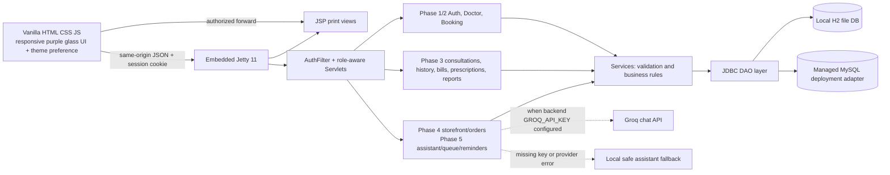

# MediSlot Architecture

## Runtime and request flow

## Design boundaries

- **Frontend:** vanilla JavaScript and same-origin `api.js`; no framework rewrite. DOM values are escaped before HTML insertion. Shared dimensional purple design and local-storage light/dark theme apply across app views. The floating assistant has its own accessible client module.
- **HTTP:** embedded Jetty routes static assets, Jakarta Servlets, filters, and secured JSP print endpoints.
- **Authentication:** server session cookie and `AuthFilter`; each API operation enforces the role and record owner in addition to filter authentication.
- **Business logic:** service classes validate fields, roles, date ranges, and state transitions.
- **Persistence:** JDBC DAO methods use prepared statements. Checkout, consultation completion, prescription-to-cart and status cancellation are transactional where cross-record consistency matters.
- **Migrations:** Flyway forward migrations are provided for H2 and MySQL under `backend/src/main/resources/db/migration/{h2,mysql}`. Local app mode uses an H2 file; tests select a disposable file under `backend/target`.
- **External service:** Groq is called only from the Java backend. `GROQ_API_KEY` is read from the process environment and never returned to the browser. The per-message context-sharing choice defaults off; selected data is queried with the session actor/role and projected to operational fields only. If the key is absent or the provider fails, a local safe response is returned.

## Phase data flow

1. **Phase 3:** assigned doctor completes visit → JDBC transaction stores note/diagnosis/treatment, completes appointment/releases slot claim, issues one bill. A completed assigned visit may receive a prescription; patient history and print views apply owner authorization.
2. **Phase 4:** patient searches catalog → cart persists medicine ids/quantities → checkout locks and rechecks current database price/stock → order lines and stock decrement commit atomically. Admin status cancellation restores stock transactionally.
3. **Phase 5:** assistant and specialty helper provide navigation-only output; today's booked appointment can get a queue token and simple per-waiting-token estimate; patient reminder reads idempotently create reminder records; timeline queries only the signed-in patient's appointments/consultations.
